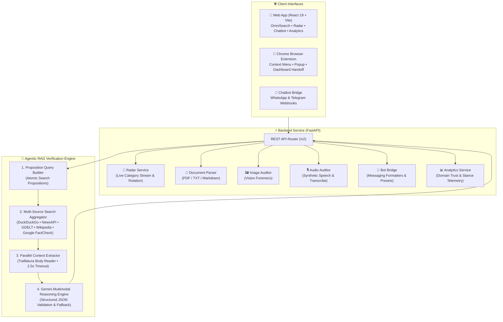

# 🔍 TruthLens AI: Real-Time News & Multimodal Claim Verification System
### *Next-Gen Multimodal Agentic RAG, Deepfake Audio/Image Forensics, Breaking News Radar & Chatbot Bridge*

[](https://www.python.org/)
[](https://fastapi.tiangolo.com/)
[](https://react.dev/)
[](https://vitejs.dev/)
[](https://aistudio.google.com/)
[](extension/)
[](#-automated-testing--quality-assurance)
[](https://opensource.org/licenses/MIT)
[-brightgreen)](#-technology-stack)

---

## 📌 1. Project Overview

**TruthLens AI** is a production-grade, multimodal news verification and investigative fact-checking platform powered by **Agentic Retrieval-Augmented Generation (RAG)** and **Google Gemini Large Language Models (LLMs)**.

Traditional machine learning fact-checkers rely on static datasets or small NLI classifiers that evaluate writing style rather than objective real-world facts. **TruthLens AI** overcomes this limitation by uniting a multi-source real-time search pipeline with multimodal forensic reasoning engines:

1. **Retrieves** breaking news, investigative reporting, academic repositories, and official government archives in real time.
2. **Audits Multimodal Artifacts** across **Text Headlines**, **Live Article URLs**, **Doctored Images & Screenshots**, **Synthetic / Cloned Audio**, and **PDF / Long-form Documents**.
3. **Reasons** over decomposed propositions using Google Gemini AI to evaluate factual agreement, numeric precision, temporal validity, and publisher credibility.
4. **Delivers** an authoritative verdict (`SUPPORTED`, `CONTRADICTED`, `MISLEADING`, `UNVERIFIED`) accompanied by structured explanations, interactive stance-colored knowledge graphs, and verbatim citations with clickable links.
5. **Combats Viral Disinformation** directly via a **Breaking News Radar feed**, a **WhatsApp / Telegram Chatbot Bridge**, and a **1-Click Chrome Browser Extension**.

---

## 🚀 2. Core Capabilities & Modalities

### 🔍 1. Agentic RAG Live Claim Verification
- **Proposition-Driven Query Decomposition:** Deconstructs complex sentences into atomic testable assertions to eliminate search dilution.
- **Multi-Source Retrieval Aggregation:** Concurrently queries DuckDuckGo News & Web, NewsAPI, GDELT, Wikipedia Reference Registry, and Google Fact Check Tools.
- **Deep Content Extraction:** Scrapes and parses full article text using `trafilatura` with strict timeout controls (2.5s bounded latency).
- **Multi-Lingual & Vernacular Engine:** Natively verifies claims in Hindi, Hinglish, Spanish, Bengali, French, German, Tamil, Telugu, and more with language-grounded retrieval.
- **Verbatim Source Citations:** Attributes findings to verified publishers (Reuters, Bloomberg, AP, BBC, The Hindu, etc.) with exact quotes.

### 📡 2. Breaking News Radar & Viral Claims Stream
- **Real-Time Detection Feed:** Live monitoring stream tracking surging viral claims and breaking headlines.
- **5 Curated Categories:** `All Trending`, `World & Politics`, `Tech & AI`, `Science & Health`, `Markets & Finance`.
- **Regional Filtering:** Targeted news streams for India (`IN`), United States (`US`), United Kingdom (`GB`), and Global feeds.
- **Dynamic IST Timestamps & Silent Background Polling:** Live Indian Standard Time indicators (`Updated: 9:26 PM IST`) with non-intrusive feed rotation.
- **1-Click "Verify Story" Integration:** Seamlessly feeds any trending radar card straight into the live RAG verification pipeline with a single click.
- **Sleek 2-Zone Glass Controls:** Modern segmented pill container inspired by Linear and Vercel design aesthetics.

### 🖼️ 3. Image & Screenshot Forensics Audit (`/v2/audit-image`)
- **Multimodal Visual Reasoning:** Employs Gemini Flash Vision to inspect social media screenshots, fabricated news graphics, and altered documents.
- **AI-Generation & Tampering Detection:** Identifies hallmarks of Midjourney, DALL-E, Flux, digital splicing, font inconsistencies, and doctored headlines.
- **Forensic Breakdown:** Provides visual authenticity scores, detected red flags, and extracted text analysis.

### 🎙️ 4. Audio Deepfake & Speech Audit (`/v2/audit-audio`, `/v2/transcribe-audio`)
- **Voice Clone & Synthetic Speech Detection:** Evaluates acoustic cadence, robotic prosody, spectral anomalies, and synthetic voice cloning artifacts.
- **Two-Stage Phonetic Normalizer:** Pairs audio transcription with phonetic claim normalization for cross-lingual forensic auditing.
- **Viral Audio Presets:** Pre-loaded audio samples for rapid one-click demonstration and benchmark testing.

### 📑 5. Long-Form Document & PDF Dossier Audit (`/v2/audit-document`, `/v2/audit-file`)
- **Multi-Format Ingestion:** Accepts PDF files, Markdown notes, or raw plain text documents.
- **Propositional Extraction:** Deconstructs multi-paragraph dossiers into distinct factual claims.
- **Claim-by-Claim Verification:** Audits each proposition independently and compiles a comprehensive dossier authenticity report.

### 🤖 6. WhatsApp & Telegram Chatbot Bridge (`/v2/bot/*`)
- **Interactive Phone Simulator:** Centered minimalist iPhone interface for testing viral forwarded messages.
- **Official Webhook Integrations:** Plug-and-play webhook endpoints for **Telegram Bot API** (`/v2/bot/webhook/telegram`) and **WhatsApp Cloud API / Twilio** (`/v2/bot/webhook/whatsapp`).
- **Bite-Sized Debunk Cards:** Generates compact, emoji-rich summary cards optimized for messaging apps.
- **Curated Viral Scenarios:** Built-in test cases for pension schemes, 5G health conspiracies, leaked exam claims, and subsidy rumors.

### 📊 7. Source Diversity & Trust Intelligence (`/v2/analytics`)
- **Domain Reliability Index:** Real-time trust ratings and historical stance telemetry across hundreds of global news outlets.
- **Stance & Bias Telemetry:** Visual breakdown of supporting vs. contradicting source distributions.

### 🌐 8. Interactive Evidence Knowledge Graph
- **Stance-Colored Topology:** Visually maps relationships between the user claim, extracted entities, and publisher evidence (`Supports` = Emerald, `Contradicts` = Rose, `Mentions` = Sky).
- **Interactive Node Inspector:** Clickable nodes displaying publisher domains, article titles, and verbatim text snippets.

### 🧩 9. 1-Click Chrome Browser Extension
- **Manifest V3 Architecture:** Lightweight background service worker with zero background drain.
- **Context Menu Integration:** Select any text on any webpage, right-click, and choose **"Verify with TruthLens"**.
- **Popup Quick-Check & Deep Handoff:** Instantly verifies claims within the browser popup or opens the full dashboard with the claim pre-populated.

### 💾 10. Audit History & Multi-Format Report Export
- **Persistent Local History:** Retains past audits in browser storage with instant search and one-click replay.
- **Multi-Format Export:** 1-click Markdown Dossier download, formatted PDF export, and clipboard summary copy.

---

## 🏗️ 3. System Architecture & Multimodal Pipeline



---

## 🔬 4. Why RAG + LLMs Outperform Traditional Fact-Checkers

| Verification Dimension | Traditional Static ML / NLI | 🌟 TruthLens AI (Multimodal Agentic RAG) |
| :--- | :--- | :--- |
| **Breaking & Dynamic News** | ❌ Fails (Training cutoff / no live internet access) | ✅ **Real-Time** (Fetches live coverage published minutes ago) |
| **Multimodal Forensics** | ❌ Text-only, ignores audio & image manipulation | ✅ **Comprehensive** (Inspects images, audio deepfakes, PDFs, and text) |
| **Vocabulary & Vernacular Nuance** | ❌ Brittle (Confused by regional idioms and slang) | ✅ **Deep Semantic Understanding** (Supports Hindi, Hinglish, Spanish, etc.) |
| **Numeric & Financial Claims** | ❌ Fragile (Fails on formatting differences like `23%` vs `23 percent`) | ✅ **Precise Verification** (Cross-checks figures against regulatory filings) |
| **Transparency & Audit Trail** | ❌ Opaque probability score | ✅ **Verbatim Citations & Knowledge Graph** with direct publisher links |
| **Cost & Scalability** | ⚠️ Expensive GPU clusters / costly APIs | ✅ **100% Free Tier ($0)** via Google AI Studio + free search endpoints |

---

## 📊 5. Verdict Classification Framework

| Verdict | Visual Badge | Meaning & Decision Criteria |
| :--- | :---: | :--- |
| **`SUPPORTED`** | `✅ SUPPORTED` | Core factual assertions, entities, numbers, and events are corroborated by credible journalistic reporting or primary sources. |
| **`CONTRADICTED`** | `❌ CONTRADICTED` | Credible reporting, official records, or scientific consensus directly disprove or refute the claim. |
| **`MISLEADING`** | `⚠️ MISLEADING` | Contains cherry-picked or partially true facts mixed with exaggerated, false, or decontextualized conclusions. |
| **`UNVERIFIED`** | `❓ UNVERIFIED` | Insufficient external reporting is currently available. *(Indicates lack of evidence, not proven falsity).* |

---

## 🛠️ 6. Technology Stack

### **Backend Core & AI Engine**
- **Framework:** Python 3.10+, [FastAPI](https://fastapi.tiangolo.com/), Pydantic v2, Uvicorn
- **Generative AI / LLMs:** Google Gemini API (`google-genai` / `google-generativeai`) using `gemini-2.0-flash` & `gemini-1.5-flash`
- **Retrievers & Search:** `ddgs` (DuckDuckGo Search), NewsAPI, GDELT 2.0 API, Wikipedia API, Google Fact Check Tools API
- **Article Extraction:** `trafilatura`, `beautifulsoup4`, `lxml_html_clean`
- **Document & Media Processing:** `pypdf`, `python-multipart`, `Pillow`
- **Testing:** Pytest (125 unit & integration tests)

### **Frontend User Interface**
- **Framework & Tooling:** [React 19](https://react.dev/), [Vite 8.3](https://vitejs.dev/)
- **Styling:** Custom Vanilla CSS (Glassmorphism, Cosmic Aurora Glow, Responsive Layout)
- **Typography:** Plus Jakarta Sans & Inter (Google Fonts)
- **Icons:** Authentic hand-crafted Vector SVG Icons (zero generic emoji clutter)
- **Networking:** Axios with automated timeout handling

### **Browser Extension**
- **Standard:** Chrome Extensions Manifest V3
- **Features:** Context menu integration, popup interface, dashboard handoff

---

## 📁 7. Repository Structure

```text
Real-Time-News-Verification-System/
├── backend/
│   ├── app/
│   │   ├── main.py                     # FastAPI application entry point, middleware & CORS
│   │   ├── predictor.py                # V1 LinearSVC ML style classifier
│   │   ├── schemas.py                  # V1 request & response models
│   │   └── v2/
│   │       ├── analytics_service.py    # 📊 Domain trust & stance telemetry engine
│   │       ├── audio_auditor.py        # 🎙️ Synthetic speech & audio deepfake detector
│   │       ├── bot_bridge.py           # 🤖 WhatsApp & Telegram chatbot bridge & presets
│   │       ├── claim_extractor.py      # Proposition & claim decomposition
│   │       ├── document_parser.py      # 📑 PDF, TXT & Markdown parser
│   │       ├── evidence_aggregator.py  # Multi-source evidence normalizer
│   │       ├── evidence_matcher.py     # Proposition-to-evidence matching engine
│   │       ├── fact_check_retriever.py # Google Fact Check Tools API integration
│   │       ├── image_auditor.py        # 🖼️ Gemini Vision forensic image analyzer
│   │       ├── news_retriever.py       # DuckDuckGo live news retriever
│   │       ├── newsapi_retriever.py    # NewsAPI REST client
│   │       ├── query_builder.py        # Proposition-driven search query builder
│   │       ├── radar_service.py        # 📡 Breaking news radar feed & background buffer
│   │       ├── rag_verifier.py         # 🧠 Core RAG AI Engine (Search + Extraction + Gemini)
│   │       ├── reference_retriever.py  # Wikipedia reference registry retriever
│   │       ├── router.py               # REST API endpoints (/v2/*)
│   │       ├── schemas.py              # Pydantic models & validation schemas
│   │       ├── semantic_verifier.py    # Semantic NLI reasoning engine
│   │       ├── verdict_engine.py       # Verdict resolution & confidence calculator
│   │       └── test_*.py               # Automated pytest suite (125 tests)
│   ├── models/                         # Pre-trained TF-IDF & LinearSVM model weights
│   └── requirements.txt                # Python backend dependencies
├── frontend/
│   ├── src/
│   │   ├── components/
│   │   │   ├── AnalyticsView.jsx       # 📊 Source diversity & trust intelligence dashboard
│   │   │   ├── ArchitectureSection.jsx # System architecture viewer
│   │   │   ├── AudioAuditView.jsx      # 🎙️ Audio deepfake audit interface
│   │   │   ├── ChatbotBridgeView.jsx   # 🤖 WhatsApp/Telegram phone simulator & presets
│   │   │   ├── DocumentAuditView.jsx   # 📑 PDF & document dossier audit interface
│   │   │   ├── EvidenceKnowledgeGraph.jsx# 🌐 Stance-colored interactive knowledge graph
│   │   │   ├── HistoryDrawer.jsx       # Persistent audit history drawer
│   │   │   ├── Icons.jsx               # Vector SVG icon library
│   │   │   ├── ImageAuditView.jsx      # 🖼️ Image & screenshot forensics interface
│   │   │   ├── OmniSearchInput.jsx     # Smart omni-input with modality switcher & presets
│   │   │   ├── RadarView.jsx           # 📡 Breaking news radar stream & controls
│   │   │   └── V2VerificationResult.jsx# Glassmorphic verdict cards & citation viewer
│   │   ├── App.jsx                     # Main application shell & tab routing
│   │   ├── api.js                      # Axios HTTP client configuration
│   │   └── index.css                   # Glassmorphic design system & micro-animations
│   ├── package.json                    # Frontend dependencies & scripts
│   └── vite.config.js                  # Vite bundler configuration
├── extension/                          # 🧩 Chrome Extension (Manifest V3)
│   ├── manifest.json                   # Extension manifest configuration
│   ├── background.js                   # Context menu & background worker
│   ├── content.js & content.css        # In-page selection overlay
│   └── popup.html & popup.js           # Extension popup interface
└── README.md                           # Project documentation
```

---

## ⚡ 8. Getting Started (Local Setup)

### **Prerequisites**
- Python `3.10+`
- Node.js `18+` and npm
- A free **Google Gemini API Key** from [Google AI Studio](https://aistudio.google.com/app/apikey) ($0 cost, no credit card required).

---

### **1. Clone the Repository**
```bash
git clone https://github.com/PrakharKashyap21/Real-Time-News-Verification-System.git
cd Real-Time-News-Verification-System
```

---

### **2. Backend Setup**

1. Create and activate a Python virtual environment:
```bash
python3 -m venv venv
source venv/bin/activate    # On Windows: venv\Scripts\activate
```

2. Install Python dependencies:
```bash
pip install -r backend/requirements.txt
```

3. Configure environment variables in `backend/.env`:
```env
GEMINI_API_KEY=your_gemini_api_key_here
# Optional additional keys:
NEWS_API_KEY=your_news_api_key_here
```

4. Launch the FastAPI server:
```bash
python3 -m uvicorn backend.app.main:app --host 127.0.0.1 --port 8008 --reload
```
* **Backend API:** `http://127.0.0.1:8008`
* **Swagger UI Documentation:** `http://127.0.0.1:8008/docs`

---

### **3. Frontend Setup**

1. Open a new terminal tab, navigate to the `frontend` directory, and install packages:
```bash
cd frontend
npm install
```

2. Start the Vite development server:
```bash
npm run dev
```
* Open [**http://localhost:5173**](http://localhost:5173) in your browser.

---

### **4. Chrome Extension Setup (Optional)**

1. Open Google Chrome and navigate to `chrome://extensions/`.
2. Enable **Developer mode** (toggle in the top-right corner).
3. Click **Load unpacked** and select the `extension/` directory from this repository.
4. Highlight any text on any webpage, right-click, and select **"Verify with TruthLens"**!

---

### **5. Automated Testing & Quality Assurance**

Run the complete backend test suite:
```bash
# Execute all 125 backend unit & integration tests
PYTHONPATH=. pytest backend/app/v2/ -q
```

Validate frontend syntax and production build:
```bash
cd frontend
npm run lint
npm run build
```

---

## 📡 9. REST API Reference

| Endpoint | Method | Description |
| :--- | :---: | :--- |
| `/v2/verify` | `POST` | Core RAG claim verification (accepts title, text, language) |
| `/v2/extract-url` | `POST` | Scrapes article title, author, and readable body from live URL |
| `/v2/radar` | `GET` | Fetches categorized breaking news radar stream (`category`, `country`, `rotate`) |
| `/v2/audit-image` | `POST` | Inspects uploaded image/screenshot for AI generation and tampering |
| `/v2/audit-audio` | `POST` | Evaluates uploaded audio file for voice cloning and synthetic artifacts |
| `/v2/transcribe-audio` | `POST` | High-speed speech-to-text transcription service |
| `/v2/audit-document` | `POST` | Audits raw multi-paragraph text dossiers claim-by-claim |
| `/v2/audit-file` | `POST` | Parses and audits uploaded PDF, TXT, or MD documents |
| `/v2/analytics` | `GET` | Returns domain trust index, stance distributions, and verification telemetry |
| `/v2/bot/verify` | `POST` | Verifies forwarded chat message and formats a bite-sized debunk card |
| `/v2/bot/presets` | `GET` | Retrieves pre-configured viral WhatsApp / Telegram forward scenarios |
| `/v2/bot/webhook/telegram`| `POST` | Standard Telegram Bot API incoming webhook receiver |
| `/v2/bot/webhook/whatsapp`| `POST` | Standard WhatsApp Cloud API / Twilio incoming webhook receiver |

### **Sample Request: Verify News Claim (`POST /v2/verify`)**

```json
{
  "title": "Trent Q2 standalone revenue",
  "text": "Indian retailer Trent reported a 23% year-on-year rise in standalone revenue in the July-September 2026 quarter.",
  "language": "auto",
  "include_linguistic_signal": true
}
```

### **Sample Response:**
```json
{
  "overall_assessment": "SUPPORTED",
  "assessment_summary": "The claim is fully substantiated by credible financial reporting on Trent's performance for the July-September quarter (Q2). Multiple outlets confirm a 23% year-on-year increase in standalone revenue.",
  "has_conflict": false,
  "claims": [
    {
      "claim_id": "claim_1",
      "text": "Indian retailer Trent reported a 23% year-on-year rise in standalone revenue in the July-September 2026 quarter.",
      "verdict": "SUPPORTED",
      "reasoning": "Multiple credible financial news sources confirm that Trent reported a 23% YoY increase in standalone revenue.",
      "evidence": [
        {
          "publisher": "Reuters",
          "domain": "reuters.com",
          "url": "https://www.reuters.com/world/india/indias-fast-fashion-retailer-trent-reports-higher-quarterly-revenue-2026-10-05/",
          "title": "India's fast-fashion retailer Trent reports higher quarterly revenue",
          "snippet": "Indian apparel retailer Trent reported a 23% year-on-year rise in standalone revenue for the second quarter...",
          "stance": "SUPPORTS"
        }
      ]
    }
  ],
  "service_status": {
    "search_engine": "ok",
    "gemini_api": "ok",
    "rag_pipeline": "active"
  }
}
```

---

## 📄 10. License

This project is licensed under the [MIT License](LICENSE).
